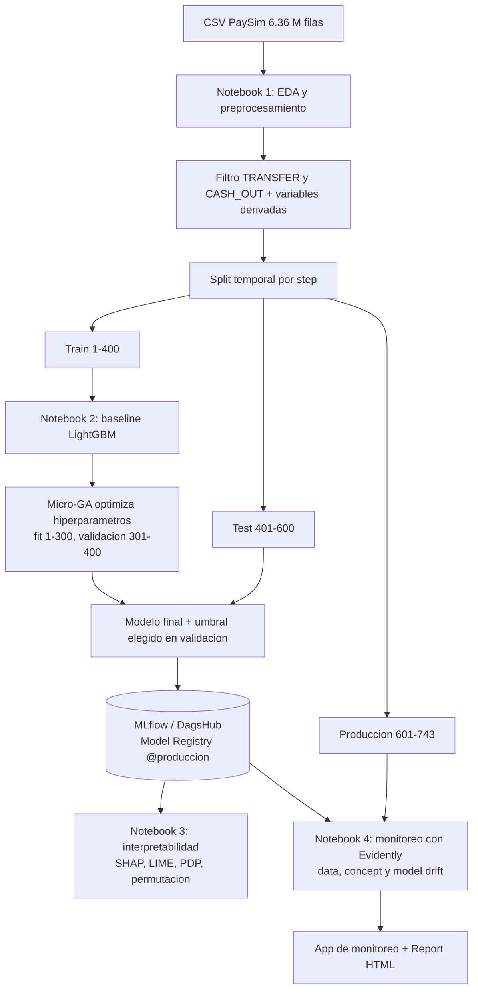

# Detección de fraude financiero (PaySim): Proyecto Curso III, ML Engineering

Clasificador supervisado de fraude en transacciones de dinero móvil, optimizado con un **micro algoritmo genético**, registrado en **MLflow (DagsHub)**, interpretado con técnicas **locales y globales** y monitoreado con **Evidently**.

- **Versión:** 1.0.0
- **Experimentos MLflow (DagsHub):** https://dagshub.com/EduardoCardoza/fraud-detection-mle3
- **Modelo productivo:** `fraude-paysim-lgbm`, versión 1, alias `@produccion` (pestaña *Models* de DagsHub)
- **Estrategia de git:** [docs/GIT_STRATEGY.md](docs/GIT_STRATEGY.md)
- **Report HTML:** [reports/reporte_data_drift_prod.html](reports/reporte_data_drift_prod.html) (descárgalo y ábrelo en el navegador)

---

## 1. Problema de ML y diagrama de flujo

**Tipo:** aprendizaje **supervisado**, subproblema de **clasificación binaria**.
**Objetivo:** predecir si una transacción es fraudulenta (`isFraud = 1`).

**Desafío principal:** desbalance extremo. Hay 8,213 fraudes en 6,362,620 transacciones (0.129%, unos 774 normales por cada fraude). Un modelo que siempre responda "no es fraude" tendría 99.87% de accuracy y no detectaría nada, por eso **no se usa accuracy**. La métrica principal es **AUPRC** (área bajo la curva precision-recall), acompañada de precision, recall y F1, siempre comparadas contra la prevalencia.



---

## 2. Dataset y diccionario de datos

**Fuente:** [PaySim](https://www.kaggle.com/datasets/ealaxi/paysim1) (simulación de transacciones de dinero móvil). Archivo `PS_20174392719_1491204439457_log.csv`, 493 MB, 6,362,620 filas × 11 columnas, **sin nulos ni duplicados**.

**Cómo obtener los datos completos:** el CSV supera el límite de GitHub y está ignorado en `.gitignore`. Descárgalo de Kaggle y colócalo en `data/raw/`. En `data/processed/` se incluyen **muestras** (`muestra_*.parquet`: todos los fraudes más 20,000 normales por tramo) para inspeccionar el formato. **Las muestras tienen prevalencia artificial y no sirven para calcular métricas.**

### Hallazgos del EDA que guían el diseño

| Hallazgo | Consecuencia |
|---|---|
| El fraude solo existe en `TRANSFER` (4,097) y `CASH_OUT` (4,116) | Se filtra a esos dos tipos (2,770,409 filas) |
| `nameOrig` y `nameDest` son identificadores casi únicos; tras filtrar, `nameDest` siempre empieza con `C` | Se descartan |
| Volumen por hora cae después del step ~400 mientras los fraudes por hora se mantienen (~10) | La prevalencia sube de 0.18% (train) a 1.08% (test) y 3.67% (prod): *prior drift* |
| La regla del sistema `isFlaggedFraud` marcó 16 transacciones, todas fraudes | Detecta el 0.19% de los fraudes (16 de 8,213). Solo línea base, no se usa como variable |

### Diccionario de datos

| Variable | Tipo | Descripción | Uso |
|---|---|---|---|
| `step` | int | Hora simulada (1 a 743, unos 30 días) | Solo para el split temporal y el monitoreo; no es variable del modelo |
| `type` | categórica | CASH_IN, CASH_OUT, DEBIT, PAYMENT, TRANSFER | Se filtra a TRANSFER y CASH_OUT |
| `amount` | float | Monto de la transacción | Variable |
| `nameOrig` | texto | Identificador del cliente origen | Descartada |
| `oldbalanceOrg` | float | Saldo del origen antes de la operación | Variable |
| `newbalanceOrig` | float | Saldo del origen después | Variable |
| `nameDest` | texto | Identificador del destinatario | Descartada |
| `oldbalanceDest` | float | Saldo del destino antes | Variable |
| `newbalanceDest` | float | Saldo del destino después | Variable |
| `isFraud` | int | **Objetivo** (1 = fraude) | Objetivo |
| `isFlaggedFraud` | int | Marca de la regla del sistema (documentada en Kaggle para transferencias de monto elevado) | Solo línea base |
| `errorBalanceOrig` | float | `newbalanceOrig + amount - oldbalanceOrg` | Derivada |
| `errorBalanceDest` | float | `oldbalanceDest + amount - newbalanceDest` | Derivada |
| `origenVacio` | int | 1 si `oldbalanceOrg == 0` | Derivada |
| `destinoVacio` | int | 1 si `oldbalanceDest == 0` | Derivada |
| `hora_dia` | int | `step % 24` | Derivada |
| `es_transfer` | int | 1 = TRANSFER, 0 = CASH_OUT | Derivada |

### Split temporal (solo TRANSFER y CASH_OUT)

| Conjunto | Steps | Filas | Fraudes | Prevalencia | Uso |
|---|---|---|---|---|---|
| Train | 1-400 | 2,529,536 | 4,477 | 0.18% | Entrenar y optimizar (ajuste 1-300, validación 301-400) |
| Test | 401-600 | 197,323 | 2,136 | 1.08% | Métricas **offline** |
| Producción | 601-743 | 43,550 | 1,600 | 3.67% | Métricas **online** (simuladas) y drift |

Se entrena con el pasado y se evalúa con el futuro. Un split aleatorio dejaría que el modelo viera fraudes de horas posteriores.

---

## 3. Técnicas de optimización de hiperparámetros

**Algoritmo:** LightGBM (`LGBMClassifier`). **Optimizador:** **micro algoritmo genético (micro-GA)**, implementado a mano siguiendo el diagrama visto en clase.

| Etapa del diagrama | Implementación |
|---|---|
| Random / Initial Population | 5 individuos al azar; cada uno son 7 genes en [0, 1] decodificados a hiperparámetros |
| Aptitude Evaluation | Entrena LightGBM y mide **AUPRC en validación** (puntaje crudo) |
| Crossing | Selección de padres por torneo de 2 |
| Recombination | Cruce BLX-α (α = 0.3) |
| Re-evaluation | Evaluación de los hijos |
| Natural Selection | Sobreviven los 5 mejores entre padres e hijos |
| Genetic Drift | Con probabilidad 0.2, perturbación gaussiana (σ = 0.05) de un individuo no élite |
| Autoregulation / New Population | Población fija en 5, genes recortados a [0, 1] |
| Nominal Convergence (ciclo interno) | Diversidad media < 0.15 |
| Elitism (ciclo externo) | Se conserva el mejor y se regeneran 4 individuos al azar |
| General Convergence | 2 ciclos sin mejora o presupuesto agotado |
| X* Solution | Mejor individuo |

> Las etapas *Genetic Drift* y *Autoregulation* son una interpretación del diagrama; ajústalas si la clase las definió distinto.

**Espacio de búsqueda:** `n_estimators` 50-300, `learning_rate` 0.01-0.3 (escala log), `num_leaves` 8-128, `min_child_samples` 5-200, `colsample_bytree` 0.5-1.0, `scale_pos_weight` 1-523 (log), `reg_lambda` 0.001-10 (log).

**Resultado:** 27 evaluaciones en dos ciclos. Mejor configuración (X*): `n_estimators=145`, `learning_rate=0.0279`, `num_leaves=84`, `min_child_samples=76`, `colsample_bytree=0.544`, `scale_pos_weight=2.09`, `reg_lambda=7.04`. En 16 de las 27 evaluaciones el AUPRC de validación fue ≥ 0.999.

**Cómo leer este resultado (importante):**
- La validación **se saturó**: la curva de convergencia llegó a 1.0 en la evaluación 2, así que las otras 25 evaluaciones no aportaron información para distinguir configuraciones.
- El baseline v2 (`reg_lambda=0`) dio AUPRC 0.478 en validación. Al reproducirlo fuera de DagsHub, **solo añadir `reg_lambda=7.04` lo llevó a 0.999**. La regularización L2 fue el factor decisivo, y el micro-GA la encontró sola; no conviene atribuirle todo el mérito de la mejora.
- Un baseline anterior (`lgbm_baseline`, peso 523 y 300 árboles, AUPRC 0.053 y umbral 1.0) quedó registrado como evidencia de inestabilidad: las probabilidades se saturaban en 1.0 y quedaban empatadas. Se corrigió midiendo con el puntaje crudo (log-odds) y con regularización.
- Spearman entre hiperparámetros y AUPRC (tendencia descriptiva, solo 27 puntos): `reg_lambda` +0.51, `learning_rate` -0.53, `scale_pos_weight` -0.55.

Todos los runs, parámetros, métricas y artefactos están en DagsHub (experimentos `fraude-paysim` y `monitoreo-fraude`). Las 27 evaluaciones aparecen anidadas bajo el run `microGA_lgbm`; la tabla está en `reports/evaluaciones_microGA.csv`.

---

## 4. Model Card

**Detalles del modelo**
- Desarrollado por: Eduardo Cardoza, Proyecto Curso III (Machine Learning Engineering)
- Fecha: octubre de 2026 · Versión: 1.0.0 (modelo registrado `fraude-paysim-lgbm` v1)
- Tipo: gradient boosting de árboles (LightGBM), clasificación binaria
- Entrenamiento: steps 1-300 de TRANSFER y CASH_OUT; 11 variables; hiperparámetros del micro-GA; el umbral (-2.1456 en log-odds) se eligió en validación (steps 301-400) con margen respecto al borde
- Licencia: MIT · Contacto: abrir un *issue* en el repositorio

**Uso previsto**
- Uso principal: priorizar para revisión transacciones `TRANSFER` y `CASH_OUT` en una simulación tipo PaySim.
- Usuarios: estudiantes y equipos de ciencia de datos como ejemplo educativo de flujo MLOps.

**Fuera de alcance**
- Tipos `PAYMENT`, `CASH_IN` y `DEBIT` (no tienen fraude en los datos, el modelo no fue entrenado con ellos).
- Decisiones reales sobre personas o dinero. Los datos son sintéticos.
- Cualquier sistema donde los saldos posteriores a la transacción no estén disponibles al decidir (ver caveats).

**Factores y métricas**
- Factores evaluados: tramo temporal (validación, test, producción) y prevalencia.
- Métricas: AUPRC (principal), ROC-AUC, precision, recall, F1. Siempre se reporta la prevalencia y el *lift* frente al azar.

**Datos de evaluación y entrenamiento:** PaySim filtrado y dividido por `step` (sección 2). No se analizó equidad por grupos demográficos porque el dataset no contiene atributos de personas.

**Análisis cuantitativo:** ver sección 5.

**Consideraciones éticas:** datos sintéticos, sin información personal. En un sistema real, los falsos positivos bloquearían a clientes legítimos y los falsos negativos dejarían pasar fraude; el umbral debe decidirse con el costo de cada error.

**Caveats y recomendaciones**
- **El rendimiento casi perfecto no es extrapolable a datos reales.** PaySim genera los fraudes con reglas y el modelo aprende una regla contable sobre los saldos del origen.
- El modelo usa `newbalanceOrig` y `newbalanceDest`, saldos *posteriores* a la operación. Solo es válido si esa información existe al momento de decidir.
- `hora_dia` es una variable frágil: refleja ciclos de volumen del simulador.
- Si los atacantes se adaptan, el rendimiento puede caer sin que el data drift lo muestre (ver sección 5, escenario simulado). Mantener el monitoreo de rendimiento con etiquetas.

---

## 5. Resultados (métricas offline y online)

### Offline (umbral fijado solo con validación)

| Conjunto | AUPRC | ROC-AUC | Precision | Recall | F1 | Prevalencia | Lift vs. azar |
|---|---|---|---|---|---|---|---|
| Validación (301-400) | 1.0000 | 1.0 | 1.0000 | 1.0000 | 1.0000 | 0.0014 | 696.1 |
| **Test (401-600)** | **0.9999** | 1.0 | 0.9995 | 0.9995 | 0.9995 | 0.0108 | 92.4 |

En test: 2,135 de 2,136 fraudes detectados, con 1 falso positivo y 1 falso negativo. El *lift* baja entre conjuntos porque su máximo posible es `1/prevalencia`; no indica degradación. Como referencia, la regla del sistema (`isFlaggedFraud`) detectó 16 de 8,213 fraudes (0.19%).

### Online (producción simulada, steps 601-743)

| Conjunto | AUPRC | Precision | Recall | F1 | Prevalencia |
|---|---|---|---|---|---|
| Producción | 1.0000 | 1.0000 | 0.9994 | 0.9997 | 0.0367 |

"Online" se simula con el tramo final de datos, que el modelo nunca vio, evaluado por ventanas de 24 steps (un día simulado) en el notebook 4. No hay un sistema en producción real.

### Monitoreo por ventanas (14 ventanas, steps 401-743)

- **Data drift (producción vs. referencia 301-400):** 3 de 11 variables superan el umbral 0.1 de Evidently: `oldbalanceOrg` (0.297), `errorBalanceOrig` (0.117) y `hora_dia` (0.108).
- **Model drift real:** ninguno. El AUPRC por ventana es ≈ 1.0 y el recall mínimo es 0.996; no se dispara ninguna alerta (umbral de diseño 0.95).
- **Concept drift real:** ninguno. La señal clave (saldo de origen coherente) aparece en 98-100% de los fraudes y en ~10-18% de los normales, estable en todas las ventanas.
- **Prior drift:** la prevalencia varía de 0.3% a 17.5% por ventana.

### Escenario simulado: fraudes adaptativos (etiquetado como SIMULACIÓN)

Una fracción creciente de fraudes (15% a 90%) imita saldos de origen sin debitar. El recall cae de 1.00 a 0.30 y la alerta de rendimiento salta desde la primera ventana perturbada. La proporción de variables con drift en este escenario (0.27 a 0.73) **no se distingue** de la de los datos reales (0.27 a 0.82): el monitoreo de data drift por sí solo no habría detectado el problema, y el de rendimiento sí.

Esta simulación demuestra que el sistema de alertas funciona; **no es un hallazgo sobre los datos reales.** Simplificación: la ventana 593-616 recibe la perturbación completa aunque cruza el step 600.

Figuras y tablas: `reports/figuras/monitoreo_real.png`, `reports/monitoreo_real.csv`, `reports/monitoreo_simulado.csv`.

---

## 6. Interpretabilidad: técnicas globales y locales

Modelo analizado: el registrado con alias `@produccion`, sobre el test. Figuras en `reports/figuras/`.

### Globales

| Técnica | Resultado |
|---|---|
| Importancia por permutación (caída de AUPRC) | `errorBalanceOrig` 0.749, `newbalanceOrig` 0.135; el resto ≤ 0.0007 |
| SHAP (media absoluta) | `errorBalanceOrig` 1.50, `newbalanceOrig` 0.87, `oldbalanceOrg` 0.81, `oldbalanceDest` 0.51, `amount` 0.45 |
| PDP (3 variables principales) | Escalón en 0 para `errorBalanceOrig` y `newbalanceOrig` |

La permutación concentra casi todo en dos variables porque el resto son redundantes: al mezclar una, las demás compensan. SHAP reparte la contribución entre variables correlacionadas. El modelo se comporta casi como una **regla sobre la coherencia contable del saldo de origen**.

### Locales (SHAP waterfall y LIME, 4 casos del test)

- **Fraude detectado:** puntaje 3.82. Suman `errorBalanceOrig = 0` (+3.49), `oldbalanceDest = 0` (+1.94), `newbalanceOrig = 0` (+1.80) y `newbalanceDest = 0` (+1.53).
- **Falso positivo:** puntaje -2.09, apenas 0.06 sobre el umbral (-2.15). Lo empuja sobre todo `hora_dia = 7` (+2.78); es un caso fronterizo.
- **Falso negativo:** puntaje -5.47. Es un fraude cuyo saldo de origen no se debitó (`newbalanceOrig`, `oldbalanceOrg` y `amount` valen 353,874.22), así que no muestra la firma dominante.
- **LIME:** pesos muy pequeños (~10⁻³) porque el modelo está casi siempre seguro. Su discretización agrupa el cero de `errorBalanceOrig` en un rango amplio y no lo destaca, mientras SHAP lo pone primero. SHAP se usa como técnica local principal y LIME como contraste.

---

## 7. Conclusiones

1. El problema es de clasificación binaria con desbalance extremo; se usaron AUPRC, precision y recall en lugar de accuracy y un split temporal para evitar fuga de información del futuro.
2. El micro-GA encontró una configuración con AUPRC de validación 1.0, pero la validación se saturó y la mejora frente al baseline se explica sobre todo por la regularización L2. La optimización es válida, aunque no debe presentarse como un afinado fino.
3. En test el modelo detecta 2,135 de 2,136 fraudes con 1 falso positivo; la regla del sistema detectaba el 0.19%.
4. Las explicaciones muestran que el modelo depende de la coherencia del saldo de origen, un patrón del simulador PaySim. El rendimiento perfecto **no es extrapolable** a datos reales.
5. El único cambio real entre periodos es de prevalencia y volumen (prior drift); no hubo concept ni model drift. El escenario simulado muestra que solo el monitoreo de rendimiento con etiquetas detecta fraudes adaptativos.
6. Trabajo futuro: validar con datos reales, probar validación cruzada temporal para que la validación no se sature, y evaluar el modelo sin variables posteriores a la transacción.

---

## Estructura del repositorio

```
notebooks/        01_preprocesamiento, 02_entrenamiento, 03_interpretabilidad, 04_monitoreo
data/raw/         CSV original (ignorado por git)
data/processed/   muestras .parquet (los archivos completos van en full/, ignorados)
monitoring_app/   app de monitoreo (Evidently UI): iniciar_app.py y workspace/
reports/          Report HTML, figuras y tablas
docs/             GIT_STRATEGY.md
```

## Cómo ejecutar

```bash
conda create -n mle3 python=3.11 -y
conda activate mle3
pip install -r requirements.txt
```

1. Descarga el CSV de PaySim a `data/raw/`.
2. Crea un archivo `.env` en la raíz con `MLFLOW_TRACKING_URI`, `MLFLOW_TRACKING_USERNAME` y `MLFLOW_TRACKING_PASSWORD` (tus credenciales de DagsHub; el archivo está en `.gitignore`).
3. Ejecuta los notebooks en orden (01 a 04). El notebook 04 regenera el workspace de monitoreo.
4. Lanza la app: `python monitoring_app/iniciar_app.py` y abre http://localhost:8000. Los dos proyectos (datos reales y escenario simulado) no necesitan credenciales.

Los notebooks 02 y 03 necesitan las credenciales de DagsHub porque leen y escriben en MLflow.